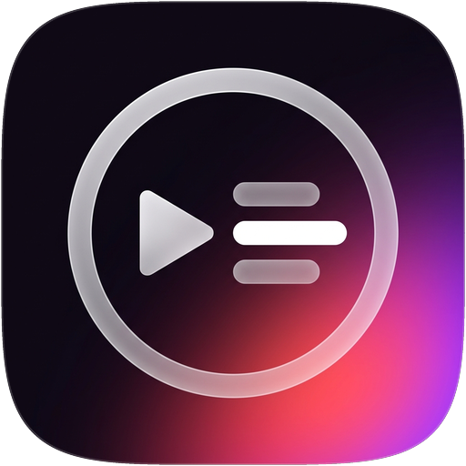

<div align="center">



# iOS YTMusic Utilities

**iOS 版 YouTube Music のためのオールインワン歌詞・プレイヤー拡張ユーティリティ**

[](https://github.com/axcyum/iOSYTM-Utils/actions/workflows/build.yml)


[](LICENSE)

**日本語** · [English](README_EN.md)

[主な機能](#主な機能) · [対応歌詞ソース](#対応歌詞ソース) · [インストール](#インストール) · [ビルド](#ビルド) · [ライセンス](#ライセンス)

</div>

---

## 概要

**iOSYTM-Utils**（`ivLyricsYTM.dylib`）は、Spicetify 向け歌詞拡張 **[ivLyrics](https://github.com/ivLis-Studio/ivLyrics)** をベースに、スマートフォンの片手操作に合わせて UI を一から再設計した iOS 版 YouTube Music 向け拡張 dylib です。

さらに以下のプロジェクト・機能を 1 つの設定画面へシームレスに統合しています。

- **[LockLyrics](https://github.com/axcyum/LockLyrics)** — ロック画面・コントロールセンターへのライブ歌詞描画
- **[YTMusic-iOS-Presence](https://github.com/axcyum/YTMusic-iOS-Presence)** — 公式 SDK ベースの Discord Rich Presence 連携
- **[SimpMusic](https://github.com/maxrave-dev/SimpMusic) インスパイア機能** — Apple Music 風イマーシブプレイヤー、Scrobble、楽曲認識、再生統計、WebNowPlaying 連携

> [!IMPORTANT]
> **クリーンポリシー**：本 Tweak は視聴体験・歌詞表示・外部サービス連携の向上のみを目的としています。**広告ブロック、YouTube Premium 機能の解放、音源ダウンロード等の制限回避機能は一切含みません。**
> 再生状態とメタデータの取得フックのみを利用しています。
---

## 主な機能

### 1. フルスクリーン歌詞 & カラオケ同期
- **単語単位のカラオケ描画**：TTML（Unison）や拡張 LRC のタイムスタンプに基づき、歌っている文字まで滑らかにハイライト。間奏アニメーション（`• • •`）やデュエット曲のパート振り分け（2 人目を右寄せ）にも対応。
- **片手・タッチ最適化 UX**：
  - **タップ**で該当箇所へシーク、**ピンチ操作**で文字サイズを自在に調整。
  - **行の長押し**で「ここから再生」「この行に同期を合わせる」「テキストをコピー」「**歌詞カードの画像共有**」を実行。
  - 親指の届く下部ツールバーに **翻訳 / 発音 / 文字サイズ / 同期補正（曲ごとに `±0.1s`・`±0.5s`） / 設定** を集約。
- **フローティング ミニ歌詞ボタン**：再生画面上の好きな位置へドラッグ配置でき、ボタン内に現在の歌詞 1 行をリアルタイム表示（タップで歌詞画面、長押しで設定）。

### 2. リアルタイム翻訳 & 完全オンデバイス発音表記
- **キー不要の歌詞翻訳**：Google 翻訳エンドポイントを利用し、API キー設定なしですぐに多言語翻訳を表示。
- **オフライン発音生成**：外部サーバーへ通信せず、iOS 端末内の形態素解析・転写エンジン（`CFStringTokenizer` / ICU）で高速生成。
  - **日本語**：ふりがな（漢字のひらがな読み）またはローマ字
  - **韓国語**：ローマ字表記
  - **中国語**：声調記号付きピンイン
  - **その他非ラテン文字**：キリル文字・タイ文字などをラテン文字へ転写
- **多言語 UI 対応**：日本語 / English / 한국어。

### 3. 内部プレイヤーシート & ロック画面歌詞
- **Now Playing プレイヤーシート**：歌詞画面のヘッダージャケットをタップ（または既定画面に設定）すると、アンビエントなカラーメッシュ背景の内部プレイヤーに切り替わります。
  - **標準モード（既定）**：曲は `1:1` の角丸ジャケット、動画は `16:9` サムネイルとして端正に表示（タッチ中に膨らむノブレスの 6pt カプセル型シークバー＆音量バー、スプリング応答のフレームレス操作ボタン、AirPlay・キュー・スリープタイマーバッジ搭載）。
  - **Apple Music 風フル画面表示（試験的）**：設定から有効化すると、ステータスバー裏まで広がるフルブリードのアートワークが段階的ブラーで背景へ溶け込む Apple Music (v27) スタイルに切り替わります。
- **ロック画面・コントロールセンター歌詞**（LockLyrics 統合）：
  - ジャケット領域に再生中の歌詞（および翻訳・発音）をライブ描画。
  - スライド＋フェードによる滑らかな行切り替え、単語カラオケ塗り、ロック画面の描画遅延を補正する「先読み時間」調整に対応。
- **テーマカスタマイズ**：アートワークぼかし / 動的カラーメッシュ / 単色 / 有機 EL 向けピュアブラックの 4 背景に加え、HEX カラーコードでアクセント色・背景色を指定可能。

### 4. 外部サービス連携 & 便利ツール
- **Discord Rich Presence**（YTMusic-iOS-Presence 統合）：再生中の曲名・アーティスト・残り時間・カバー画像に加え、「YouTube Music で聴く」リンクボタンや GitHub ボタンをアクティビティに表示。カスタム表示名や更新間隔（3〜60 秒）も設定画面から変更でき、フレームワーク注入不要の `dlopen` 方式により **LiveContainer でもそのまま動作**します。
- **WebNowPlaying（LAN 連携）**：同一 LAN 内の PC アダプター（[WebNowPlaying-Rainmeter](https://github.com/keifufu/WebNowPlaying-Rainmeter) 等、rev legacy / 1 / 2 / 3）へ曲情報・ジャケット・再生位置を送信し、PC 側からの再生・一時停止・スキップ・シーク操作にも対応。
- **Scrobble（再生記録）**：**Last.fm** および **ListenBrainz** に対応。認証情報は iOS Keychain に安全に保存され、オフライン時は永続キューから自動再送します。
- **周囲の曲を認識（ShazamKit）**：流れている音楽を Apple の ShazamKit で認識し、そのまま YouTube Music アプリ内で開きます。
- **ローカル再生統計 & スリープタイマー**：端末内完結の再生統計（7 日 / 30 日 / 全期間、時間帯グラフ、よく聴く曲・アーティスト）と、分数指定または「この曲の終わりで停止」を選べるスリープタイマーを搭載。

---

## 対応歌詞ソース

有効なプロバイダーを並列検索し、**単語同期 ＞ 行同期 ＞ プレーンテキスト** の優先度（同じ同期精度なら設定の並び順）で自動採用します。曲ごとにプロバイダーを手動で固定することも可能です。

| プロバイダー | 同期精度 | 概要・特徴 |
| :--- | :---: | :--- |
| **YouTube Music 公式** | 行同期 | アプリ標準「歌詞」タブと同一データ（InnerTube モバイル API から時間同期付きで取得） |
| **Unison** | 単語同期 | TTML 形式のカラオケワイプ・間奏表示・デュエットパート分けに対応 |
| **LyricsPlus** | 単語 / 行同期 | Apple Music・Musixmatch 系の高精度タイムスタンプ歌詞 |
| **Lyrically** | 単語 / 行同期 | Apple Music カタログおよび KuGou ソースに対応 |
| **Spotify** | 行同期 | 設定から `open.spotify.com` にログインして取得（認証情報は端末内 WebKit のみに保持） |
| **LRCLIB** | 拡張 / 行同期 | キーワードによる手動検索・長押しプレビュー・曲ごとのピン留めに対応 |
| **動画の字幕** | 行同期 | MV 等の字幕トラックを利用（言語自動推定・トラック選択に対応、自動生成字幕は除外） |

> [!TIP]
> `(Official Video)` や `- Topic`、`feat.` などの表記揺れは検索前に自動整形されます。また、日本語・韓国語・中国語の楽曲でローマ字化された歌詞が返ってきた場合は自動的に優先度を下げ、本来の文字の歌詞を優先します。

---

## インストール

既定ビルドの `ivLyricsYTM.dylib` は Objective-C ランタイムを直接利用する単体ライブラリのため、**CydiaSubstrate / ElleKit なしでサイドロード環境・LiveContainer でそのまま動作**します。

### LiveContainer の場合
1. YouTube Music コンテナの `Tweaks` フォルダを開きます。
2. `ivLyricsYTM.dylib`（Discord 連携を使う場合は `discord_partner_sdk.dylib` も）を配置するだけで完了です。

### IPA 注入（cyan / Feather / ESign / Sideloadly）
1. 復号済みの YouTube Music IPA を用意します。
2. `ivLyricsYTM.dylib`（および必要に応じて `discord_partner_sdk.dylib`）を注入して署名・インストールします。

```bash
# cyan (pyzule-rw) を使う場合の例
cyan -i YouTubeMusic.ipa -o YouTubeMusic_Utils.ipa -uwsf ivLyricsYTM.dylib discord_partner_sdk.dylib
```

- **GitHub Actions での自動注入**：リポジトリの Actions から `Build ivLyricsYTM` を手動実行（`workflow_dispatch`）し、`ipa_url` に復号済み IPA の URL を指定すると、注入済み IPA が Artifacts に生成されます。

### IPA注入(Windows/Linux/MacOS [Impactor](https://github.com/claration/impactor))
<br>
初期設定をすまし、サイドローディングができるようになったら、TweakからDylibを選択、インストールで完了です。<br>
2個以上（DiscordSDK等）も同時にできます


### 脱獄環境（Jailbreak）
Rootful / Rootless / Roothide それぞれの `.deb` パッケージに対応しています。Sileo や Zebra 等からインストールしてください。

> [!WARNING]
> **重複注入の注意**：`LockLyrics` と `YTMusic-iOS-Presence` はすでに本 Tweak に統合されています。ロック画面描画や Discord 送信の二重動作を防ぐため、旧単体版の dylib / Tweak は同時に導入しないでください。

---

## ビルド

macOS、[Theos](https://theos.dev)、および Xcode（iOS 18 以降の SDK）が必要です。

```bash
# 既定: サイドロード / LiveContainer 向け単体 dylib (.theos/obj/ivLyricsYTM.dylib)
make package

# 脱獄環境向け .deb パッケージ
make package JAILBREAK=1             # Rootful
make package JAILBREAK=1 ROOTLESS=1  # Rootless
make package JAILBREAK=1 ROOTHIDE=1  # Roothide

# Discord Rich Presence を有効化してビルド（公式 Discord Social SDK の iOS 実機スライスを指定）
make package DISCORD_SDK=/path/to/discord_partner_sdk.xcframework/ios-arm64
```

- **フレームワーク注入不要の Discord SDK 読み込み**：ビルド時に `tools/gen_discord_stubs.py` がヘッダーから C API の転送スタブを自動生成し、実行時に `ivLyricsYTM.dylib` と同階層の `discord_partner_sdk.dylib` を `dlopen` で動的バインドします。
- CI（`.github/workflows/build.yml`）では、`build-inputs` リリースに `discord-sdk.zip` が配置されていれば自動で Discord 対応ビルドを行い、Swift ランタイムの `@rpath` 書き換え済み `discord_partner_sdk.dylib` を同梱します。

---

## 詳細設定・開発者向け情報

<details>
<summary><b>WebNowPlaying の PC 側ポート開放手順（Rainmeter 等）</b></summary>
<br>

1. 設定 → **WebNowPlaying** を開き、PC の LAN 内 IP アドレスとポート番号（Rainmeter の既定値は `8974`）を入力します。
2. PC 側のアダプターが `127.0.0.1` のみで待ち受けている場合は、管理者権限の PowerShell / コマンドプロンプトで以下を実行して LAN に公開し、Windows ファイアウォールで TCP `8974` 番ポートを許可してください。

```powershell
netsh interface portproxy add v4tov4 listenport=8974 listenaddress=0.0.0.0 connectport=8974 connectaddress=127.0.0.1
```

</details>

<details>
<summary><b>プロジェクト構成・フック仕様</b></summary>
<br>

```text
Sources/
├── Tweak.x                             # メインフック（YTPlayerVC / YTMNowPlayingVC / YTMAvatarAccountView）
├── YTMHeaders.h                        # YouTube Music プライベート API 宣言
├── IVLPlaybackManager.*                # 曲変更検出・再生位置補間・オフセット計算・シーク
├── IVLLyricsService.*                  # 7 ソース並列検索・自動優先度判定・表記整形・キャッシュ
├── IVLYouTubeProvider.m                # YouTube Music 公式同期歌詞（InnerTube browse）
├── IVLExtraProviders.m                 # LyricsPlus / Lyrically プロバイダー
├── IVLCaptionsProvider.m               # MV 字幕トラック取得・言語自動選択
├── IVLSpotify.*                        # WebKit ログイン・Web Player 経由の Spotify 歌詞取得
├── IVLLyricsParser.*                   # LRC / 拡張 LRC / TTML / プレーンテキストパーサー
├── IVLTranslator.*                     # Google 翻訳 & オンデバイス発音生成（CFStringTokenizer / ICU）
├── IVLLyricsViewController.*           # フルスクリーン歌詞 UI
├── IVLPlayerPanel.*                    # Apple Music v27 スタイルのイマーシブプレイヤーシート
├── IVLLyricCell.*                      # カラオケ 2 パス描画セル（TextKit クリップ描画）
├── IVLFloatingButton.*                 # ドラッグ可能なミニ歌詞フローティングボタン
├── IVLProviderPickerViewController.*   # 曲別プロバイダー比較・固定ピッカー & 字幕トラック選択
├── IVLSearchViewController.*           # LRCLIB キーワード手動検索・プレビュー
├── IVLLockScreen.*                     # ロック画面・コントロールセンター歌詞描画
├── IVLDiscord.* / IVLDiscordLog.*      # Discord Rich Presence（dlopen スタブ連携）
├── IVLWebNowPlaying.*                  # WebNowPlaying クライアント（rev legacy / 1 / 2 / 3）
├── IVLRemoteControl.*                  # メディアリモート操作ブリッジ
├── IVLScrobbler.*                      # Last.fm / ListenBrainz Scrobble & 永続再送キュー
├── IVLRecognizer.*                     # ShazamKit 楽曲認識連携
├── IVLExtras.*                         # テーマ・スリープタイマー・ローカル再生統計・歌詞画像共有
└── IVLSettings* / IVLLocalization.* / IVLModels.*
```

**利用している主なフックポイント**：
- `-[YTPlayerViewController playbackController:didActivateVideo:withPlaybackData:]` / `singleVideo:currentVideoTimeDidChange:`
- `currentVideoMediaTime` / `seekToTime:` / `playerResponse.playerData.videoDetails`
- `-[YTMNowPlayingViewController viewDidLoad]` / `-[YTMAvatarAccountView setAccountMenuUpperButtons:lowerButtons:]`
- `-[MPNowPlayingInfoCenter setNowPlayingInfo:]`（公開 API）

アプリのアップデートで内部クラス・セレクタが変更されてもクラッシュしないよう、すべての呼び出しを `respondsToSelector:` で保護し、対象クラスが存在する場合のみ `%init` を実行する安全設計を採っています。

</details>

<details>
<summary><b>Spicetify 版 ivLyrics との違い・注意事項</b></summary>
<br>

- **未移植の機能**：API キーを要する外部 AI 翻訳／発音（ChatGPT / Claude / Gemini 等 — 発音はオンデバイス生成で代替）、動画背景、コミュニティ同期オフセット共有、マーケットプレイス、学習モード、同期データ作成ツール、Vinyl モードはモバイル UX や Spotify 固有仕様の都合上含めていません。
- **イコライザー等について**：YouTube Music の再生パイプラインへ安全に音声処理を差し込む手段がないため、イコライザー・リバーブ・クロスフェードは搭載していません。
- **非公開 API と免責事項**：YouTube Music 内部フック、Spotify Web API、Google 翻訳エンドポイントはいずれも非公式仕様のため、サービス側の変更により予告なく動作しなくなる場合があります。また、サイドロード時の署名プロファイルによっては ShazamKit が利用できない場合があります。歌詞および翻訳の著作権は各権利者に帰属します。

</details>

---

## ライセンス

本プロジェクトは **[GPL-3.0](LICENSE)** ライセンスの下で配布されています。

- 統合している `YTMusic-iOS-Presence`（GPL-3.0）のコードを含むため、リポジトリ全体を GPL-3.0 として提供しています。
- `ivLyrics` 由来のコードは LGPL-2.1 であり、同ライセンス第 3 条に基づき GPL として扱っています（原文は [LICENSE.ivLyrics-LGPL-2.1](LICENSE.ivLyrics-LGPL-2.1) を参照）。
- 公式 Discord Social SDK は Discord 社のライセンスに従うため、本リポジトリのソースツリーには同梱していません。

### クレジット・謝辞
- **[ivLyrics](https://github.com/ivLis-Studio/ivLyrics)** © ivLis STUDIO
- **[LyricsPlus](https://github.com/ibratabian17/LyricsPlus)** / **Unison** / **Lyrically (Paxsenix)** / **[LRCLIB](https://lrclib.net/)**
- **[SimpMusic](https://github.com/maxrave-dev/SimpMusic)** / **[WebNowPlaying](https://github.com/keifufu/WebNowPlaying)** / **[YTMusicUltimate](https://github.com/dayanch96/YTMusicUltimate)**

<details>
<summary><sub>...</sub></summary>

<sub><code>discord_partner_sdk.dylib</code> の生成手順（公式 Discord Social SDK の <code>ios-arm64</code> スライスを使用）：</sub>

```bash
cp path/to/discord_partner_sdk.xcframework/ios-arm64/discord_partner_sdk.framework/discord_partner_sdk discord_partner_sdk.dylib
for lib in $(otool -L discord_partner_sdk.dylib | awk '/@rpath\/libswift/ {print $1}'); do
  install_name_tool -change "$lib" "/usr/lib/swift/${lib#@rpath/}" discord_partner_sdk.dylib
done
install_name_tool -id @rpath/discord_partner_sdk.dylib discord_partner_sdk.dylib
ldid -S discord_partner_sdk.dylib
```

<sub>またはフォーク先リポジトリの <code>build-inputs</code> リリース（Pre-release）に公式 SDK を <code>discord-sdk.zip</code> として配置し、GitHub Actions（<code>Build ivLyricsYTM</code>）を実行すると自動生成されます。</sub>

</details>
