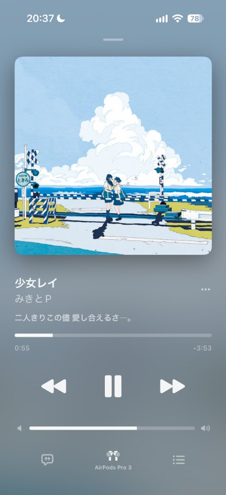
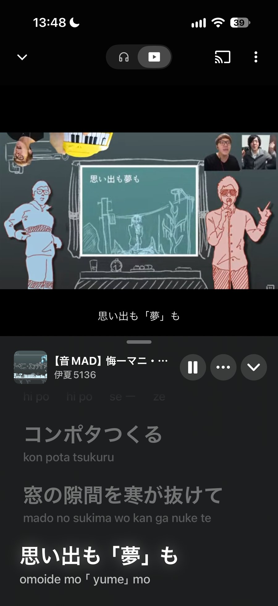
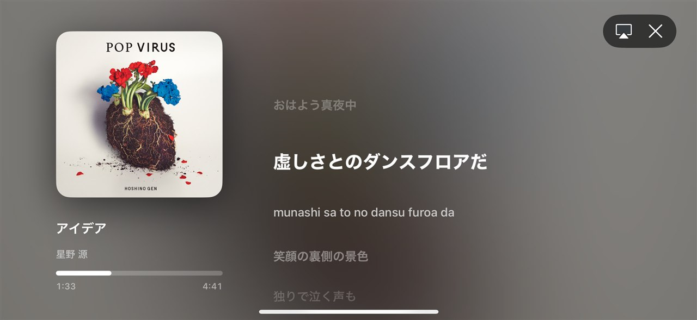
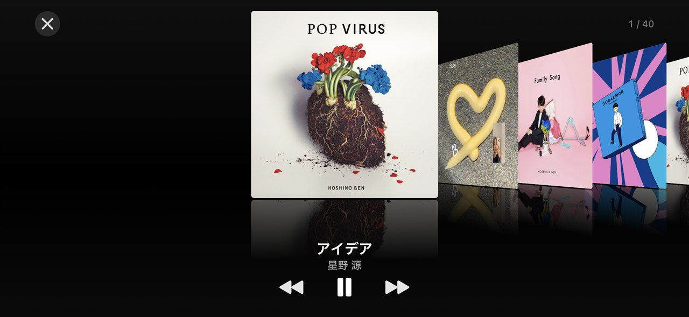
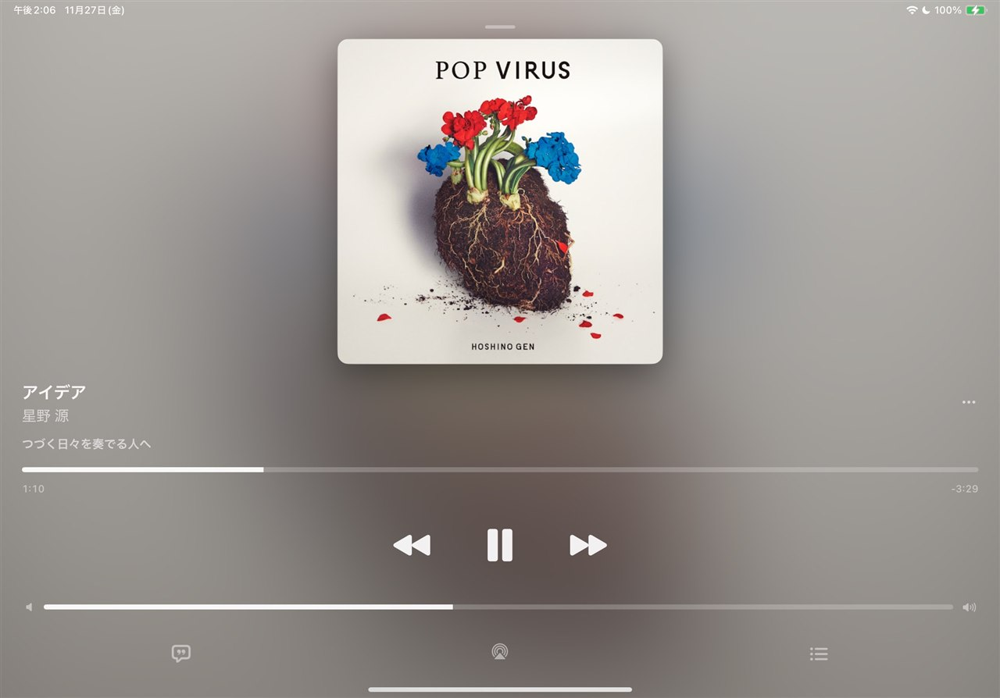
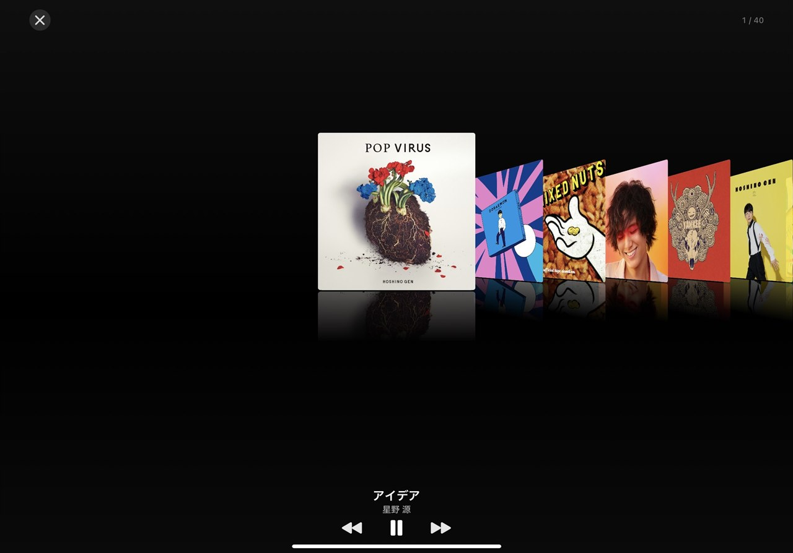
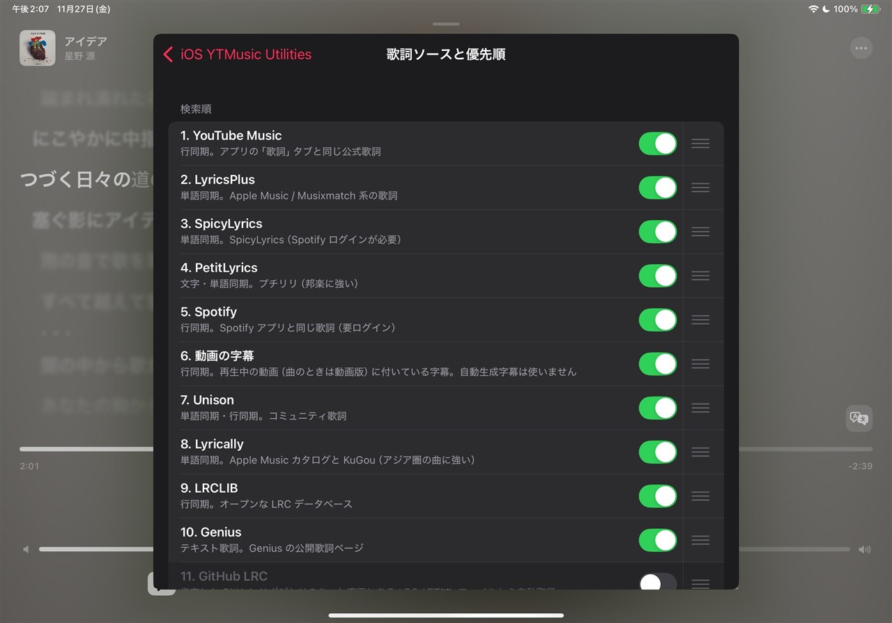

<div align="center">


# iOS YTMusic Utilities

**iOS 版 YouTube Music のためのオールインワン歌詞・オーディオ DSP・プレイヤー拡張ユーティリティ**

[](https://github.com/axcyum/iOSYTM-Utils/actions/workflows/build.yml)


[](LICENSE)

**日本語** · [English](README_EN.md)

[スクリーンショット](#スクリーンショット) · [主な機能](#主な機能) · [対応歌詞ソース](#対応歌詞ソース) · [インストール](#インストール) · [ビルド](#ビルド) · [ライセンス](#ライセンス)

</div>

---

## 概要

**iOSYTM-Utils**（`ivLyricsYTM.dylib`）は、Spicetify 向け歌詞拡張 **[ivLyrics](https://github.com/ivLis-Studio/ivLyrics)** をベースに、Apple Human Interface Guidelines に沿った片手操作 UI・リアルタイム音声 DSP・外部ディスプレイ投影を統合した iOS 版 YouTube Music 向け拡張 dylib です。

さらに以下のプロジェクト・機能を 1 つのネイティブ設定画面およびクイックメニューへシームレスに統合しています。

- **[LockLyrics](https://github.com/axcyum/LockLyrics)** — ロック画面・コントロールセンターへのライブ歌詞描画
- **[YTMusic-iOS-Presence](https://github.com/axcyum/YTMusic-iOS-Presence)** — 公式 SDK ベースの Discord Rich Presence 連携
- **リアルタイム・オンデバイス Audio DSP** — カスタム 6 バンド EQ、ボーカル除去（カラオケ）、最大 300% の音量ブースト
- **TV・AirPlay フルスクリーン歌詞ステージ** — HDMI / 画面ミラーリング向けの Apple TV 風 16:9 ライブ歌詞表示
- **[SimpMusic](https://github.com/maxrave-dev/SimpMusic) インスパイア機能** — Apple Music 風イマーシブプレイヤー、Scrobble、楽曲認識、再生統計、WebNowPlaying 連携

> [!IMPORTANT]
> **クリーンポリシー**：本 Tweak は視聴体験・歌詞表示・音質カスタマイズ・外部サービス連携の向上のみを目的としています。**広告ブロック、YouTube Premium 機能の解放、音源ダウンロード等の制限回避機能は一切含みません。**

---

## スクリーンショット

### iPhone 18 Pro（iOS 27.0.1 · Non-Jailbroken / Sideload）

<div align="center">
<table>
  <tr>
    <td align="center" width="33%">
      
    </td>
    <td align="center" width="33%">
      
    </td>
    <td align="center" width="33%">
      
    </td>
  </tr>
  <tr>
    <td align="center"><sub><b>内部プレイヤー</b><br>アンビエント背景・ミニ歌詞・AirPods 動的表示</sub></td>
    <td align="center"><sub><b>オーディオ & EQ</b><br>6バンド EQ・カラオケ・音量ブースト</sub></td>
    <td align="center"><sub><b>同期歌詞 & 字幕</b><br>翻訳・発音表記・Apple HIG メニュー</sub></td>
  </tr>
</table>
<table>
  <tr>
    <td align="center" width="50%">
      
    </td>
    <td align="center" width="50%">
      
    </td>
  </tr>
  <tr>
    <td align="center"><sub><b>TV・AirPlay 16:9 歌詞ステージ</b><br>HDMI / 画面ミラーリング対応</sub></td>
    <td align="center"><sub><b>横画面 3D Cover Flow（試験的）</b><br>再生キュー連動・反射エフェクト</sub></td>
  </tr>
</table>
</div>

### iPad Pro 2020（A12Z · iPadOS 18.5 · Jailbroken）

<details open>
<summary><b>iPad 実機スクリーンショットを表示（7 枚）</b></summary>
<br>
<div align="center">
<table>
  <tr>
    <td align="center" width="50%">
      
    </td>
    <td align="center" width="50%">
      
    </td>
  </tr>
  <tr>
    <td align="center"><sub><b>Apple Music 風 UI（試験的）</b></sub></td>
    <td align="center"><sub><b>Apple Music 風 歌詞表示（試験的）</b></sub></td>
  </tr>
  <tr>
    <td align="center" width="50%">
      
    </td>
    <td align="center" width="50%">
      
    </td>
  </tr>
  <tr>
    <td align="center"><sub><b>ivLyrics フルスクリーン歌詞</b></sub></td>
    <td align="center"><sub><b>オーディオ & 6バンド EQ</b></sub></td>
  </tr>
  <tr>
    <td align="center" width="50%">
      
    </td>
    <td align="center" width="50%">
      
    </td>
  </tr>
  <tr>
    <td align="center"><sub><b>3D Cover Flow（試験的）</b></sub></td>
    <td align="center"><sub><b>TV・AirPlay 16:9 歌詞ステージ</b></sub></td>
  </tr>
  <tr>
    <td align="center" colspan="2">
      
      <br><sub><b>歌詞ソースと優先順（11 系統・ドラッグ並び替え）</b></sub>
    </td>
  </tr>
</table>
</div>
</details>

<sub>**スクリーンショット内の表示楽曲**：[少女レイ — みきとP](https://music.youtube.com/watch?v=b6abJ4NlzsE)（iPhone 内部プレイヤー） · [【音MAD】悔ーマニ・エンゲイザー — 伊夏5136](https://www.youtube.com/watch?v=XGvQghwuuS0)（iPhone 動画字幕） · [アイデア — 星野源](https://music.youtube.com/watch?v=bwqurkN3vhE)（その他 iPhone / iPad 全般）</sub>
---

## 主な機能

### 1. フルスクリーン歌詞 & カラオケ同期
- **単語・文字単位のカラオケ描画**：TTML（Unison / SpicyLyrics）、プチリリ（`<wsy>` 文字同期）、拡張 LRC のタイムスタンプに基づき、歌っている箇所まで滑らかにハイライト。間奏アニメーション（`• • •`）やデュエット曲のパート振り分けにも対応。
- **Apple HIG 準拠のクイックメニュー & 片手 UX**：
  - `•••` メニュー上部に **オーディオ / TV出力 / タイマー** の 3 タイル・クイックバーを配置し、再生中でもワンタップでハーフシートを呼び出し可能。
  - **タップ**で該当箇所へシーク、**ピンチ操作**で文字サイズ調整、**行の長押し**で「ここから再生」「同期補正」「コピー」「**歌詞カードの画像共有**」を実行。
  - 下部ツールバーに **翻訳 / 発音 / 文字サイズ / 同期補正（曲ごとに `±0.1s`・`±0.5s`） / メニュー** を集約。
- **フローティング ミニ歌詞ボタン & ホーム下部ミニ歌詞バー（試験的）**：再生画面上の好きな位置へドラッグ配置できるミニ歌詞ピルに加え、ホーム画面のミニプレイヤー直下に現在の歌詞を表示するスリムバーも選択可能。

### 2. リアルタイム翻訳 & 完全オンデバイス発音表記
- **キー不要の歌詞翻訳**：Google 翻訳エンドポイントを利用し、API キー設定なしですぐに多言語翻訳を表示。
- **オフライン発音生成**：外部サーバーへ通信せず、iOS 端末内の形態素解析・転写エンジン（`CFStringTokenizer` / ICU）で高速生成。
  - **日本語**：ふりがな（漢字のひらがな読み）またはローマ字
  - **韓国語**：ローマ字表記
  - **中国語**：声調記号付きピンイン
  - **その他非ラテン文字**：キリル文字・タイ文字などをラテン文字へ転写
- **多言語 UI 対応**：日本語 / English / 한국어。

### 3. リアルタイム・オンデバイス Audio DSP（EQ・カラオケ・音量ブースト）
YouTube Music の圧縮オーディオストリーム（Opus / AAC）を端末内の `AudioConverter` でリアルタイム展開し、Float32 ステレオ PCM 上で直接エフェクト処理を行います（すべて OFF のときは負荷ゼロでパススルー）。
- **カスタム 6 バンド・イコライザー**：`60Hz`（ローシェルフ）/ `150Hz` / `400Hz` / `1kHz` / `2.4kHz` / `12kHz`（ハイシェルフ）の ±12 dB パラメトリック/グラフィック EQ。周波数カーブを直接タッチ＆ドラッグして自在に調整できるほか、**フラット / 低音強調 / 高音強調 / ボーカル / ロック / アコースティック** のプリセットを搭載（ダブルタップで単一バンドを 0 dB にリセット）。
- **カラオケモード（リアルタイム・ボーカル除去）**：低音域（キック・ベース）と高音域（ハイハット・空気感）を保持したまま、中央定位のボーカル帯域のみを端末内でリアルタイム除去（0〜100% で強度調整可能）。
- **音量ブースト（最大 300%）**：YouTube 側のラウドネス正規化による減衰を解除しつつ、`tanh` ソフトクリッパー保護付きで音割れを防ぎながら最大 300% まで増幅。

### 4. TV・AirPlay フルスクリーン表示 & プレイヤー外観
- **HDMI / AirPlay 16:9 歌詞ステージ**：
  - HDMI アダプタ接続や画面ミラーリング時に、ジャケット・プログレスバー・単語同期カラオケ歌詞を配した Apple TV 風の 16:9 フルスクリーンステージを外部ディスプレイへ出力。通常ミラーリング環境向けに端末側を横 16:9 ステージ化するモード（回転ロック中でも自動横向き）や AirPlay 出力先ピッカーも同梱。
  - **スマート中央寄せアニメーション**：歌詞が存在しない楽曲ではジャケットと曲情報・プログレスバーがスプリングアニメーションで画面中央へ美しく移動し、次の曲に切り替わると自動で左カラムへ戻って「歌詞を探しています…」を表示します。
- **内部プレイヤーシート & 試験的 UI モード**：
  - **標準モード（既定）**：曲は `1:1` 角丸ジャケット、動画は `16:9` サムネイルで端正に表示。
  - **Apple Music 風フル画面表示 & 歌詞表示（試験的）**：フルブリードのアートワークと光学ブラーを備えた Apple Music スタイル UI。
  - **横画面 Cover Flow（試験的）**：端末を横向きにすると、実際の再生キューと連動した iOS 6 風 3D Cover Flow（反射・慣性スクロール対応）を表示。
- **ロック画面・コントロールセンター歌詞**（LockLyrics 統合）& **4 種のテーマ / HEX カラー指定**。

### 5. 外部サービス連携 & 便利ツール
- **Discord Rich Presence**（YTMusic-iOS-Presence 統合）：曲名・アーティスト・残り時間・カバー画像・表示ステータス形式（Activity Name / Artist / Title）・リンクボタンを表示。`dlopen` スタブ方式により **LiveContainer でもそのまま動作**します。
- **WebNowPlaying（LAN 連携）**：同一 LAN 内の PC アダプター（[WebNowPlaying-Rainmeter](https://github.com/keifufu/WebNowPlaying-Rainmeter) 等、rev legacy / 1 / 2 / 3）と双方向連携（指数バックオフ＆自動クリーンアップ対応）。
- **Scrobble（再生記録）**：**Last.fm** および **ListenBrainz** に対応（Keychain 保存・オフライン永続再送キュー搭載）。
- **周囲の曲を認識（ShazamKit）** / **ローカル再生統計** / **スリープタイマー**。

---

## 対応歌詞ソース

有効なプロバイダーを並列検索し、**単語同期 ＞ 行同期 ＞ プレーンテキスト** の優先度（同じ同期精度なら設定の並び順）で自動採用します。曲ごとにプロバイダーを手動で固定したり、ローカルの `.lrc` / `.ttml` ファイルを直接読み込むことも可能です。

| プロバイダー | 同期精度 | 概要・特徴 |
| :--- | :---: | :--- |
| **YouTube Music 公式** | 行同期 | アプリ標準「歌詞」タブと同一データ（InnerTube モバイル API から時間同期付きで取得） |
| **Unison** | 単語同期 | TTML 形式のカラオケワイプ・間奏表示・デュエットパート分けに対応 |
| **LyricsPlus** | 単語 / 行同期 | Apple Music・Musixmatch 系の高精度タイムスタンプ歌詞 |
| **Lyrically** | 単語 / 行同期 | Apple Music カタログおよび KuGou ソースに対応（アジア圏の楽曲に強力） |
| **SpicyLyrics** | 単語 / 行同期 | 音節・単語同期に対応した高精度歌詞（設定の Spotify ログインと連携） |
| **PetitLyrics（プチリリ）** | 文字 / 単語 / 行 | `<wsy>` 文字単位同期に対応。邦楽・アニメソング・ボカロ楽曲に特に強力 |
| **Spotify** | 行同期 | 設定から `open.spotify.com` にログインして取得（認証情報は端末内 WebKit のみに保持） |
| **LRCLIB** | 拡張 / 行同期 | キーワードによる手動検索・長押しプレビュー・曲ごとのピン留めに対応 |
| **Genius** | プレーンテキスト | 同期歌詞が見つからない洋楽・ヒップホップ等のフォールバックに最適 |
| **GitHub LRC / ローカルファイル** | 単語 / 行同期 | 複数の GitHub リポジトリ登録・ファイル一覧ブラウザ、および「ファイル」アプリからの `.lrc` / `.ttml` 直接インポートに対応 |
| **動画の字幕** | 行同期 | MV 等の公式字幕トラックを利用（言語自動推定・トラック選択に対応、自動生成字幕は除外） |

> [!TIP]
> `(Official Video)` や `- Topic`、`feat.` などの表記揺れは検索前に自動整形されます。また、日本語・韓国語・中国語の楽曲でローマ字化された歌詞が返ってきた場合は自動的に優先度を下げ、本来の文字の歌詞を優先します。

---

## インストール

既定ビルドの `ivLyricsYTM.dylib` は Objective-C ランタイムを直接利用する単体ライブラリのため、**CydiaSubstrate / ElleKit なしでサイドロード環境・LiveContainer でそのまま動作**します。

### LiveContainer の場合
1. YouTube Music コンテナの `Tweaks` フォルダを開きます。
2. `ivLyricsYTM.dylib`（Discord 連携を使う場合は `discord_partner_sdk.dylib` も）を配置するだけで完了です。

### IPA 注入（cyan / Feather / ESign / Sideloadly）
1. 復号済みの YouTube Music IPA を用意します。
2. `ivLyricsYTM.dylib`（および必要に応じて `discord_partner_sdk.dylib`）を注入して署名・インストールします。

```bash
# cyan (pyzule-rw) を使う場合の例
cyan -i YouTubeMusic.ipa -o YouTubeMusic_Utils.ipa -uwsf ivLyricsYTM.dylib discord_partner_sdk.dylib
```

- **GitHub Actions での自動注入**：リポジトリの Actions から `Build ivLyricsYTM` を手動実行（`workflow_dispatch`）し、`ipa_url` に復号済み IPA の URL を指定すると、注入済み IPA が Artifacts に生成されます。

### IPA 注入 楽 (Windows/Linux/MacOS [Impactor](https://github.com/claration/impactor))
<br>
初期設定をすまし、サイドローディングができるようになったら、TweakからDylibを選択、
インストールを押して完了です。2個以上（DiscordSDK等）も同時にできます


### 脱獄環境（Jailbreak）
Rootful / Rootless / Roothide それぞれの `.deb` パッケージに対応しています。Sileo や Zebra 等からインストールしてください。

> [!WARNING]
> **重複注入の注意**：`LockLyrics` と `YTMusic-iOS-Presence` はすでに本 Tweak に統合されています。ロック画面描画や Discord 送信の二重動作を防ぐため、旧単体版の dylib / Tweak は同時に導入しないでください。

---

## ビルド

macOS、[Theos](https://theos.dev)、および Xcode（iOS 18 以降の SDK）が必要です。

```bash
# 既定: サイドロード / LiveContainer 向け単体 dylib (.theos/obj/ivLyricsYTM.dylib)
make package

# 脱獄環境向け .deb パッケージ
make package JAILBREAK=1             # Rootful
make package JAILBREAK=1 ROOTLESS=1  # Rootless
make package JAILBREAK=1 ROOTHIDE=1  # Roothide

# Discord Rich Presence を有効化してビルド（公式 Discord Social SDK の iOS 実機スライスを指定）
make package DISCORD_SDK=/path/to/discord_partner_sdk.xcframework/ios-arm64
```

- **フレームワーク注入不要の Discord SDK 読み込み**：ビルド時に `tools/gen_discord_stubs.py` がヘッダーから C API の転送スタブを自動生成し、実行時に `ivLyricsYTM.dylib` と同階層の `discord_partner_sdk.dylib` を `dlopen` で動的バインドします。
- CI（`.github/workflows/build.yml`）では、`build-inputs` リリースに `discord-sdk.zip` が配置されていれば自動で Discord 対応ビルドを行い、Swift ランタイムの `@rpath` 書き換え済み `discord_partner_sdk.dylib` を同梱します。

---

## 詳細設定・開発者向け情報

<details>
<summary><b>WebNowPlaying の PC 側ポート開放手順（Rainmeter 等）</b></summary>
<br>

1. 設定 → **WebNowPlaying** を開き、PC の LAN 内 IP アドレスとポート番号（Rainmeter の既定値は `8974`）を入力します。
2. PC 側のアダプターが `127.0.0.1` のみで待ち受けている場合は、管理者権限の PowerShell / コマンドプロンプトで以下を実行して LAN に公開し、Windows ファイアウォールで TCP `8974` 番ポートを許可してください。

```powershell
netsh interface portproxy add v4tov4 listenport=8974 listenaddress=0.0.0.0 connectport=8974 connectaddress=127.0.0.1
```

</details>

<details>
<summary><b>プロジェクト構成・フック仕様</b></summary>
<br>

```text
Sources/
├── Tweak.x                             # メインフック（YTPlayerVC / AVSampleBufferAudioRenderer 等）
├── YTMHeaders.h                        # YouTube Music プライベート API 宣言
├── IVLPlaybackManager.*                # 曲変更検出・再生位置補間・オフセット計算・シーク
├── IVLLyricsService.*                  # 複数ソース並列検索・自動優先度判定・表記整形・キャッシュ
├── IVLYouTubeProvider.m                # YouTube Music 公式同期歌詞（InnerTube browse）
├── IVLExtraProviders.m                 # LyricsPlus / Lyrically プロバイダー
├── IVLMoreProviders.m                  # SpicyLyrics / PetitLyrics（プチリリ） / Genius プロバイダー
├── IVLGitHubProvider.*                 # マルチリポジトリ対応 GitHub LRC プロバイダー & ブラウザ
├── IVLCaptionsProvider.m               # MV 字幕トラック取得・言語自動選択
├── IVLSpotify.*                        # WebKit ログイン・Web Player 経由の Spotify トークン & 歌詞取得
├── IVLLyricsParser.*                   # LRC / 拡張 LRC / TTML / プレーンテキストパーサー
├── IVLTranslator.*                     # Google 翻訳 & オンデバイス発音生成（CFStringTokenizer / ICU）
├── IVLAudioDSP.*                       # リアルタイム PCM デコード・6バンド EQ・カラオケ・音量ブースト
├── IVLExternalDisplay.*                # HDMI / AirPlay 16:9 歌詞ステージ & フルスクリーン TV モード
├── IVLCoverFlow.*                      # 実キュー連動 iOS 6 風 3D Cover Flow（試験的）
├── IVLHomeBarLyrics.*                  # ホーム画面ミニプレイヤー下部ライブ歌詞バー（試験的）
├── IVLLyricsViewController.*           # フルスクリーン歌詞 UI & Apple HIG クイックメニュー
├── IVLPlayerPanel.*                    # 内部プレイヤーシート & Apple Music 風歌詞ビュー
├── IVLLyricCell.*                      # カラオケ 2 パス描画セル（TextKit キャッシュ最適化済み）
├── IVLFloatingButton.*                 # ドラッグ可能なミニ歌詞フローティングボタン
├── IVLProviderPickerViewController.*   # 曲別ソース比較・ローカル LRC 読込・字幕トラック選択
├── IVLSearchViewController.*           # LRCLIB キーワード手動検索・プレビュー
├── IVLLockScreen.*                     # ロック画面・コントロールセンター歌詞描画
├── IVLDiscord.* / IVLDiscordLog.*      # Discord Rich Presence（dlopen スタブ連携）
├── IVLWebNowPlaying.*                  # WebNowPlaying クライアント（rev legacy / 1 / 2 / 3）
├── IVLRemoteControl.*                  # メディアリモート操作ブリッジ
├── IVLScrobbler.*                      # Last.fm / ListenBrainz Scrobble & 永続再送キュー
├── IVLRecognizer.*                     # ShazamKit 楽曲認識連携
├── IVLExtras.*                         # テーマ・スリープタイマー・ローカル再生統計・歌詞画像共有
└── IVLSettings* / IVLLocalization.* / IVLModels.*
```

**利用している主なフックポイント**：
- `-[YTPlayerViewController playbackController:didActivateVideo:withPlaybackData:]` / `singleVideo:currentVideoTimeDidChange:`
- `-[YTIPlaylistPanelRenderer contentsArray]`（Cover Flow キュー同期）
- `-[AVSampleBufferAudioRenderer enqueueSampleBuffer:]` / `setVolume:`（オンデバイス Audio DSP）
- `-[YTMNowPlayingViewController viewDidLoad]` / `-[YTMAvatarAccountView setAccountMenuUpperButtons:lowerButtons:]`
- `-[MPNowPlayingInfoCenter setNowPlayingInfo:]`（公開 API）

アプリのアップデートで内部クラス・セレクタが変更されてもクラッシュしないよう、すべての呼び出しを `respondsToSelector:` で保護し、対象クラスが存在する場合のみ `%init` を実行する安全設計を採っています。

</details>

<details>
<summary><b>Spicetify 版 ivLyrics との違い・注意事項</b></summary>
<br>

- **iOS 版独自の拡張**：リアルタイム 6 バンド EQ・ボーカル除去（カラオケ）・音量ブースト、HDMI / AirPlay 16:9 歌詞ステージ、ロック画面歌詞描画、横画面 3D Cover Flow、ShazamKit 曲認識などを独自搭載しています。
- **未移植の機能**：API キーを要する外部 AI 翻訳／発音（発音はオンデバイス生成で代替）、動画背景、コミュニティ同期オフセット共有、マーケットプレイス、学習モード、同期データ作成ツール、Vinyl モードはモバイル UX の都合上含めていません。
- **非公開 API と免責事項**：YouTube Music 内部フック、各歌詞プロバイダー API、Google 翻訳エンドポイントはいずれも非公式仕様のため、サービス側の変更により予告なく動作しなくなる場合があります。また、サイドロード時の署名プロファイルによっては ShazamKit が利用できない場合があります。歌詞および翻訳の著作権は各権利者に帰属します。

</details>

---

## ライセンス

本プロジェクトは **[GPL-3.0](LICENSE)** ライセンスの下で配布されています。

- 統合している `YTMusic-iOS-Presence`（GPL-3.0）のコードを含むため、リポジトリ全体を GPL-3.0 として提供しています。
- `ivLyrics` 由来のコードは LGPL-2.1 であり、同ライセンス第 3 条に基づき GPL として扱っています（原文は [LICENSE.ivLyrics-LGPL-2.1](LICENSE.ivLyrics-LGPL-2.1) を参照）。
- 公式 Discord Social SDK は Discord 社のライセンスに従うため、本リポジトリのソースツリーには同梱していません。

### クレジット・謝辞
- **[ivLyrics](https://github.com/ivLis-Studio/ivLyrics)** © ivLis STUDIO
- **[LyricsPlus](https://github.com/ibratabian17/LyricsPlus)** / **Unison** / **Lyrically (Paxsenix)** / **SpicyLyrics** / **PetitLyrics** / **[LRCLIB](https://lrclib.net/)** / **Genius**
- **[SimpMusic](https://github.com/maxrave-dev/SimpMusic)** / **[WebNowPlaying](https://github.com/keifufu/WebNowPlaying)** / **[YTMusicUltimate](https://github.com/dayanch96/YTMusicUltimate)**

<details>
<summary><sub>...</sub></summary>

<sub><code>discord_partner_sdk.dylib</code> の生成手順（公式 Discord Social SDK の <code>ios-arm64</code> スライスを使用）：</sub>

```bash
cp path/to/discord_partner_sdk.xcframework/ios-arm64/discord_partner_sdk.framework/discord_partner_sdk discord_partner_sdk.dylib
for lib in $(otool -L discord_partner_sdk.dylib | awk '/@rpath\/libswift/ {print $1}'); do
  install_name_tool -change "$lib" "/usr/lib/swift/${lib#@rpath/}" discord_partner_sdk.dylib
done
install_name_tool -id @rpath/discord_partner_sdk.dylib discord_partner_sdk.dylib
ldid -S discord_partner_sdk.dylib
```

<sub>またはフォーク先リポジトリの <code>build-inputs</code> リリース（Pre-release）に公式 SDK を <code>discord-sdk.zip</code> として配置し、GitHub Actions（<code>Build ivLyricsYTM</code>）を実行すると自動生成されます。</sub>

</details>
