<div align="center">

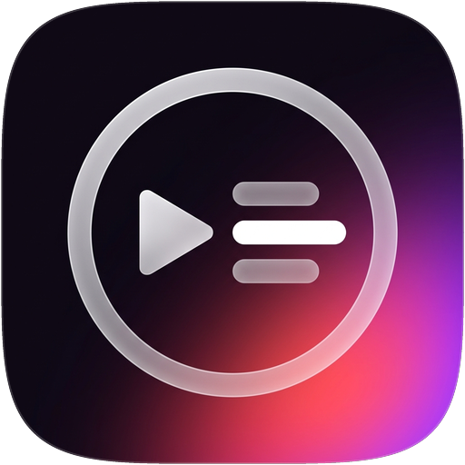

# iOS YTMusic Utilities

**All-in-one synced lyrics, real-time Audio DSP, TV stage & utility suite for YouTube Music on iOS**

[](https://github.com/axcyum/iOSYTM-Utils/actions/workflows/build.yml)


[](LICENSE)

[日本語](README.md) · **English**

[Screenshots](#screenshots) · [Features](#features) · [Lyrics Providers](#lyrics-providers) · [Installation](#installation) · [Building](#building) · [License](#license)

</div>

---

## Overview

**iOSYTM-Utils** (`ivLyricsYTM.dylib`) brings **[ivLyrics](https://github.com/ivLis-Studio/ivLyrics)** (originally built for Spicetify) to YouTube Music on iOS with an Apple HIG-inspired one-handed UI, real-time on-device Audio DSP, and external TV/AirPlay lyrics projection.

It unifies several companion tweaks and utilities into a single native experience:

- **[LockLyrics](https://github.com/axcyum/LockLyrics)** — Live synced lyrics rendered directly on the iOS Lock Screen & Control Center artwork
- **[YTMusic-iOS-Presence](https://github.com/axcyum/YTMusic-iOS-Presence)** — Official SDK-powered Discord Rich Presence
- **Real-Time On-Device Audio DSP** — Interactive 6-band custom Equalizer, Karaoke vocal remover & soft-clipped Volume Boost (up to 300%)
- **TV & AirPlay 16:9 Lyrics Stage** — Apple TV-style fullscreen lyrics projection over HDMI & Screen Mirroring
- **[SimpMusic](https://github.com/maxrave-dev/SimpMusic)-inspired Utilities** — Apple Music-style immersive Now Playing sheet, scrobbling, ShazamKit song recognition, listening stats & WebNowPlaying LAN sync

> [!IMPORTANT]
> **Clean Policy**: This tweak focuses strictly on lyrics, playback UX, audio customization, and ecosystem integrations. **It contains zero ad-blocking, Premium-unlocking, audio-downloading, or restriction-bypassing code.**

---

## Screenshots (v1.2.0)

### iPhone 18 Pro (A20 Pro · iOS 27.0.1 · Non-Jailbroken / Sideload)

<div align="center">
<table>
  <tr>
    <td align="center" width="25%">
      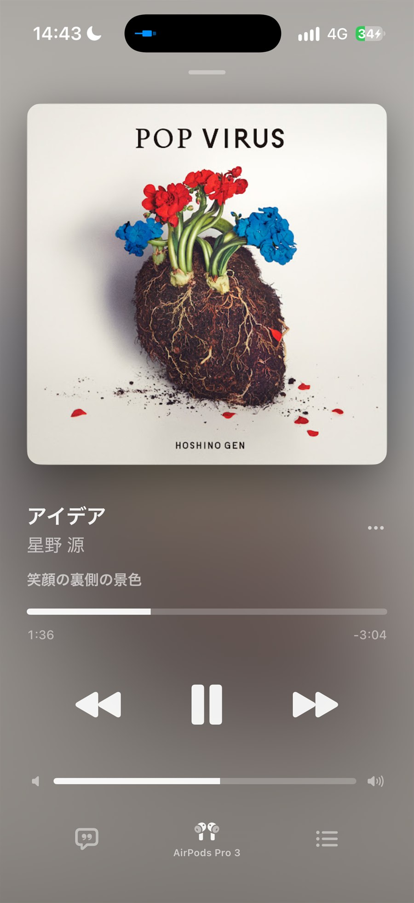
    </td>
    <td align="center" width="25%">
      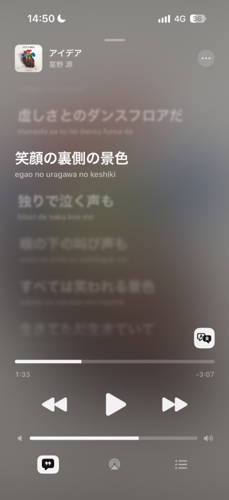
    </td>
    <td align="center" width="25%">
      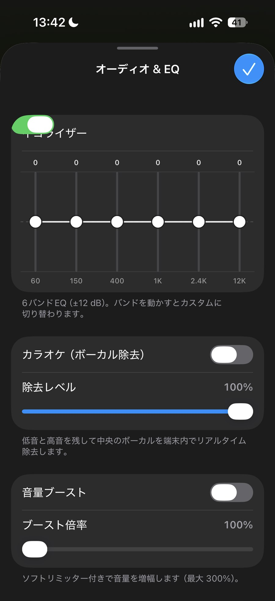
    </td>
    <td align="center" width="25%">
      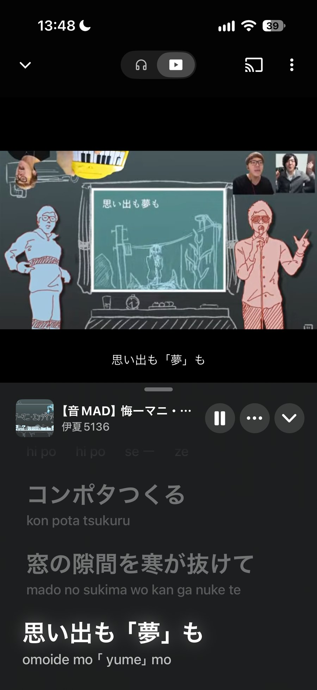
    </td>
  </tr>
  <tr>
    <td align="center"><sub><b>Apple Music-Style UI (Experimental)</b><br>Full-bleed backdrop · dynamic AirPods route</sub></td>
    <td align="center"><sub><b>Apple Music-Style Lyrics (Experimental)</b><br>Optical blur · live pronunciation</sub></td>
    <td align="center"><sub><b>Audio & EQ</b><br>6-Band EQ · Karaoke · Volume Boost</sub></td>
    <td align="center"><sub><b>Subtitles to Lyrics</b><br>Translation · Pronunciation</sub></td>
  </tr>
</table>
<table>
  <tr>
    <td align="center" width="50%">
      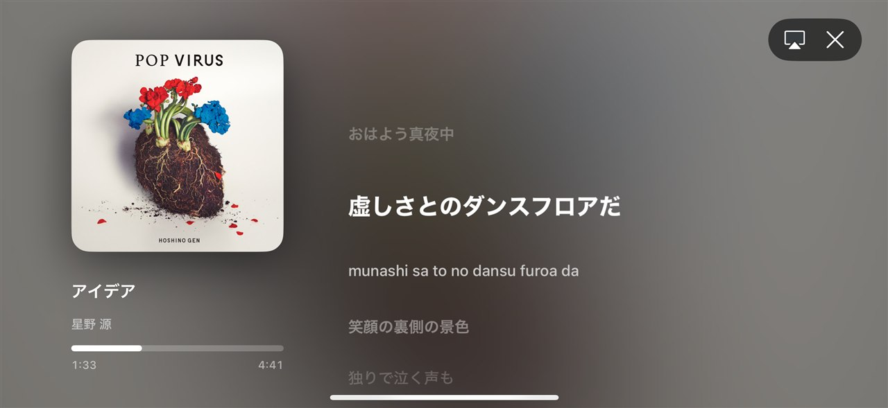
    </td>
    <td align="center" width="50%">
      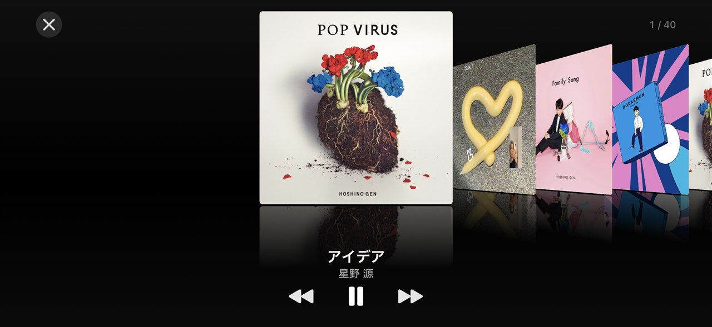
    </td>
  </tr>
  <tr>
    <td align="center"><sub><b>TV & AirPlay 16:9 Stage</b><br>HDMI & Screen Mirroring</sub></td>
    <td align="center"><sub><b>Landscape 3D Cover Flow (Experimental)</b><br>Live queue synced · floor reflections</sub></td>
  </tr>
</table>
</div>

### iPad Pro 2020 (A12Z · iPadOS 18.5 · Jailbroken)

<details open>
<summary><b>Show iPad Screenshots (7)</b></summary>
<br>
<div align="center">
<table>
  <tr>
    <td align="center" width="50%">
      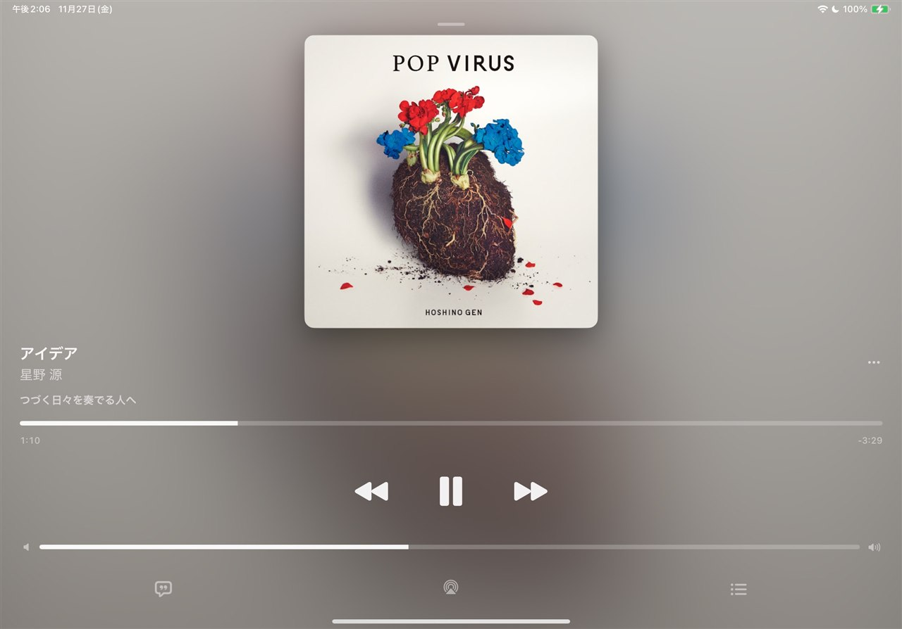
    </td>
    <td align="center" width="50%">
      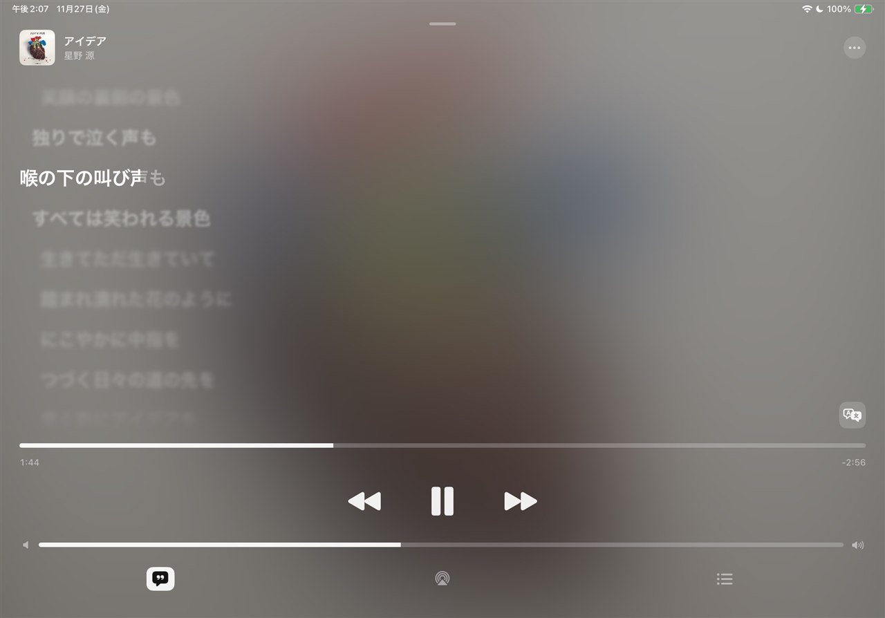
    </td>
  </tr>
  <tr>
    <td align="center"><sub><b>Apple Music-Style UI (Experimental)</b></sub></td>
    <td align="center"><sub><b>Apple Music-Style Lyrics (Experimental)</b></sub></td>
  </tr>
  <tr>
    <td align="center" width="50%">
      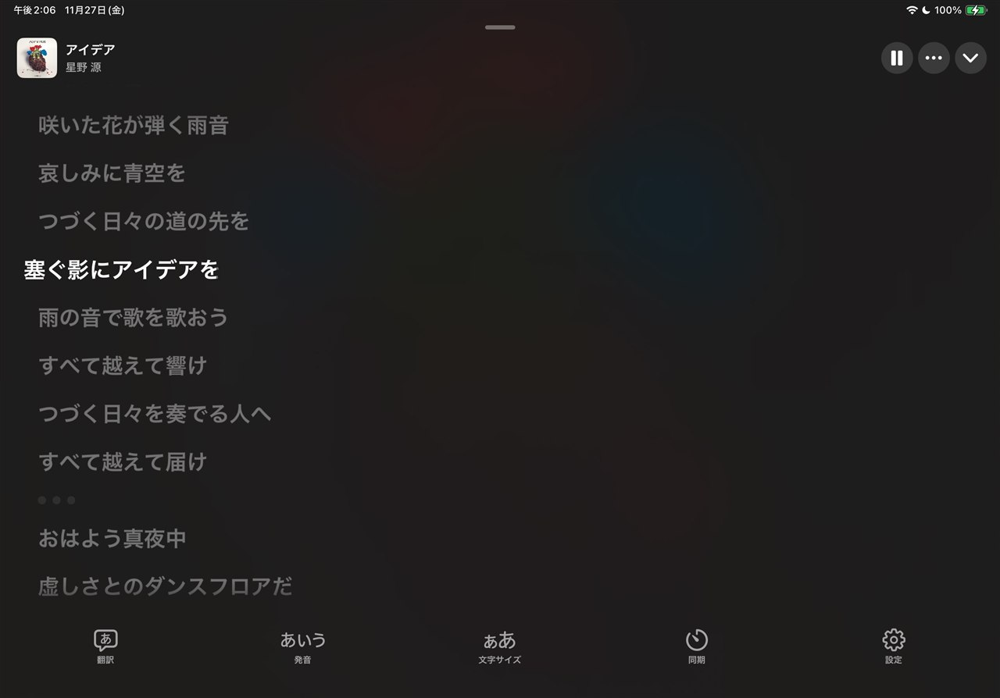
    </td>
    <td align="center" width="50%">
      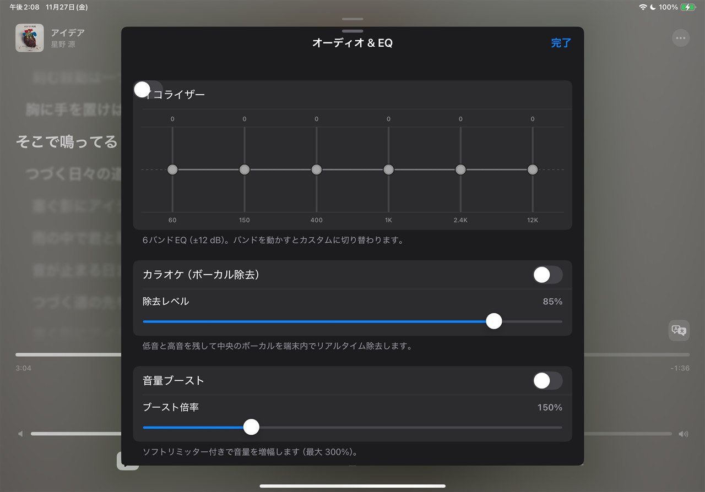
    </td>
  </tr>
  <tr>
    <td align="center"><sub><b>ivLyrics Fullscreen Lyrics</b></sub></td>
    <td align="center"><sub><b>Audio & 6-Band EQ</b></sub></td>
  </tr>
  <tr>
    <td align="center" width="50%">
      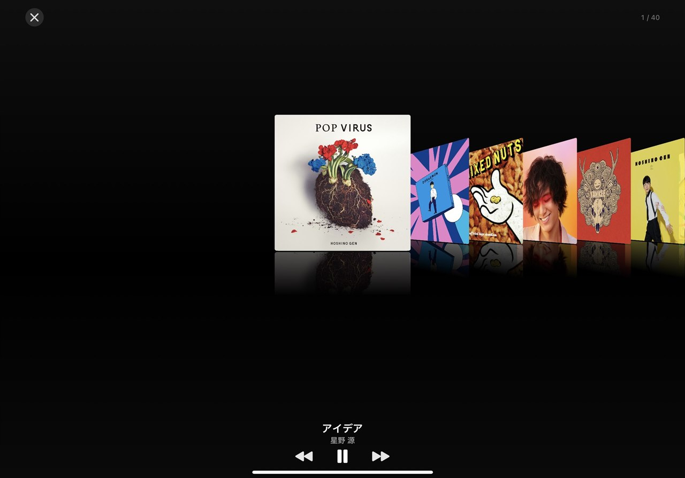
    </td>
    <td align="center" width="50%">
      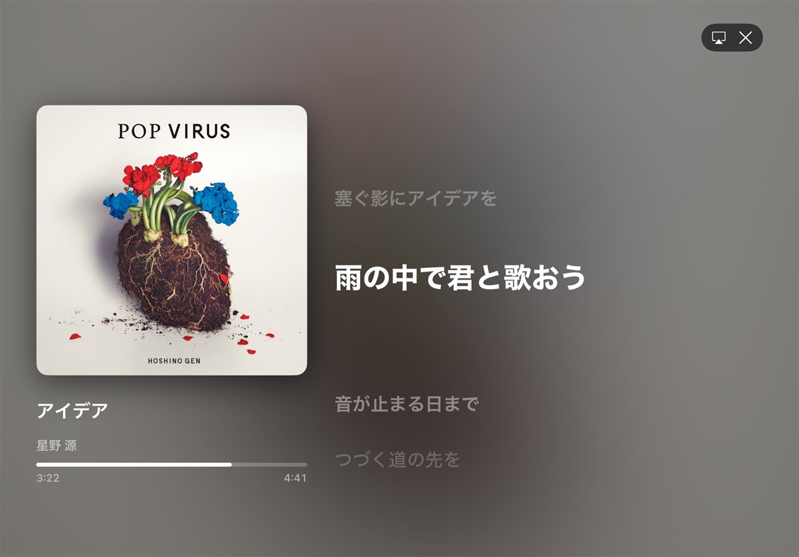
    </td>
  </tr>
  <tr>
    <td align="center"><sub><b>3D Cover Flow (Experimental)</b></sub></td>
    <td align="center"><sub><b>TV & AirPlay 16:9 Stage</b></sub></td>
  </tr>
  <tr>
    <td align="center" colspan="2">
      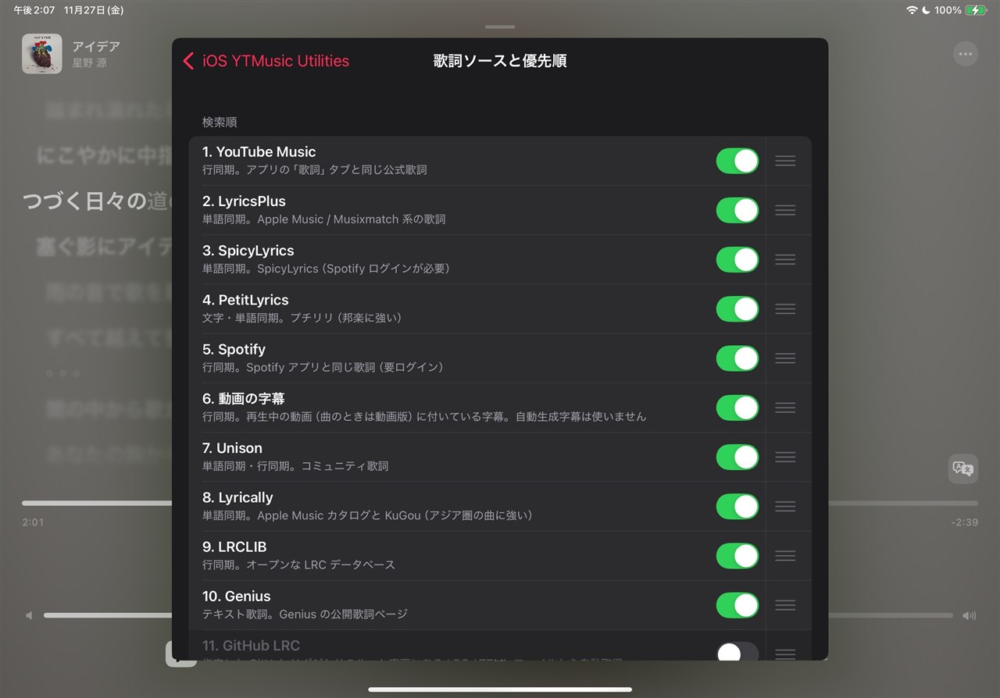
      <br><sub><b>Lyrics Sources & Priority (11 sources · drag-to-reorder)</b></sub>
    </td>
  </tr>
</table>
</div>
</details>

### Lock Screen & Discord Rich Presence

<div align="center">
<table>
  <tr>
    <td align="center" width="50%">
      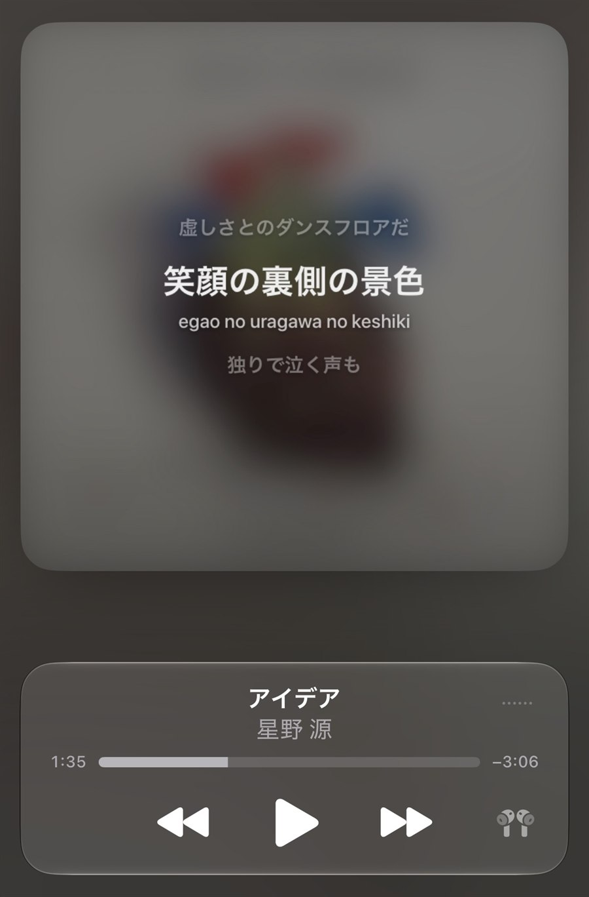
    </td>
    <td align="center" width="50%">
      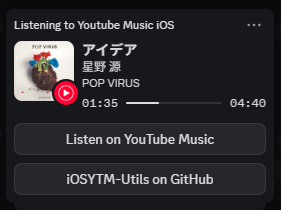
    </td>
  </tr>
  <tr>
    <td align="center"><sub><b>Lock Screen & Control Center Lyrics</b><br>LockLyrics integrated · live pronunciation</sub></td>
    <td align="center"><sub><b>Discord Rich Presence</b><br>Live progress bar · direct YouTube Music link</sub></td>
  </tr>
</table>
</div>

<sub>**Featured Tracks in Screenshots**:<br>
[Idea — Gen Hoshino](https://music.youtube.com/watch?v=bwqurkN3vhE) (iPhone & iPad screenshots)<br>
[【音MAD】悔一マニ・エンゲイザー — 伊夏5136](https://www.youtube.com/watch?v=XGvQghwuuS0) (iPhone Subtitles to Lyrics)</sub>

---

## Features

### 1. Full-Screen Synced Lyrics & Apple HIG Controls
- **Word & Character Karaoke Fill**: Smooth syllable/character progress powered by TTML (Unison / SpicyLyrics), PetitLyrics (`<wsy>`), and enhanced LRC timestamps, with instrumental breaks (`• • •`) and duet vocal alignment.
- **Apple HIG Context Menus & Gestures**:
  - Top 3-tile quick bar (**Audio · TV Out · Timer**) inside the `•••` menu for instant half-sheet access during playback.
  - **Tap** any line to seek, **pinch** to resize lyrics, or **long-press** a line to seek, sync timing, copy text, or **share a stylized lyric image card**.
- **Draggable Mini-Lyric Pill & Home Mini-Bar Lyrics (Experimental)**: Floating Now Playing pill plus an optional live lyric strip beneath the Home tab's mini player bar.

### 2. Translation & 100% On-Device Pronunciation
- **Zero-Key Translation**: Instant multi-language lyric translation via Google Translate's web endpoint — no API keys required.
- **Offline Pronunciation Engine**: Generated entirely on-device (`CFStringTokenizer` / ICU) for Japanese (Furigana / Romaji), Korean (Romaji), Chinese (tone-marked Pinyin), and other non-Latin scripts.
- **Localized UI**: English / 日本語 / 한국어.

### 3. Real-Time On-Device Audio DSP (EQ, Karaoke & Volume Boost)
Decodes YouTube Music's compressed Opus / AAC stream in real time via Apple's `AudioConverter` to apply studio-grade Float32 stereo DSP (zero-cost passthrough when all effects are off):
- **Custom 6-Band Equalizer**: Interactive `60Hz` / `150Hz` / `400Hz` / `1kHz` / `2.4kHz` / `12kHz` (±12 dB) graphic & biquad equalizer with live Bezier curve sculpting and built-in presets (**Flat, Bass Boost, Treble Boost, Vocal, Rock, Acoustic, Custom**).
- **Karaoke Vocal Remover**: Isolates and removes center-panned vocals on-device in real time while preserving sub-bass punch and crisp high-frequency percussion.
- **Volume Boost (up to 300%)**: Lifts loudness-normalized renderer attenuation and amplifies output with smooth `tanh` soft-clipping protection.

### 4. TV & AirPlay Stage, Player Styles & Lock Screen
- **HDMI & AirPlay 16:9 Lyrics Stage**: Projects an Apple TV-style fullscreen stage over HDMI or Screen Mirroring (plus an on-device 16:9 stage modal that works even with Portrait Lock enabled). Automatically spring-animates artwork and metadata to the center when a song has no lyrics, and glides back to the left ("Searching for lyrics…") when the next song starts.
- **Experimental Player Styles**: Apple Music full-bleed UI, inline optical-blur lyrics, and **iOS 6-style Landscape 3D Cover Flow** synced with your live playback queue.
- **Lock Screen & Control Center Lyrics** (LockLyrics integrated) + **4 Theme Styles & Custom Hex Colors**.

### 5. Ecosystem Integrations & Extras
- **Discord Rich Presence** (YTMusic-iOS-Presence integrated): Configurable status display, cover art & action buttons; works in **LiveContainer** via `dlopen` stubs.
- **WebNowPlaying (LAN)**, **Last.fm & ListenBrainz Scrobbling**, **ShazamKit Song Recognition**, **On-Device Listening Stats**, and **Sleep Timer**.

---

## Lyrics Providers

All enabled sources are queried in parallel and ranked automatically by **Word-Synced > Line-Synced > Plain Text**, breaking ties using your drag-and-drop provider order. You can also pin a provider per song or import local `.lrc` / `.ttml` files.

| Provider | Sync Level | Notes |
| :--- | :---: | :--- |
| **YouTube Music** | Line-Synced | Official app lyrics fetched with timestamps via mobile InnerTube |
| **Unison** | Word-Synced | Rich TTML karaoke fill, instrumental breaks & duet vocal alignment |
| **LyricsPlus** | Word / Line | High-accuracy Apple Music / Musixmatch-sourced synced lyrics |
| **Lyrically** | Word / Line | Backed by Apple Music catalog & KuGou sources |
| **SpicyLyrics** | Word / Line | Syllable-synced lyrics powered by your signed-in Spotify session |
| **PetitLyrics** | Char / Word / Line | `<wsy>` character-synced lyrics — exceptional coverage for Japanese music |
| **Spotify** | Line-Synced | Sign in to `open.spotify.com` in settings (credentials stay in local WebKit) |
| **LRCLIB** | Enhanced / Line | Includes manual keyword search, long-press preview & per-song pinning |
| **Genius** | Plain Text | Reliable fallback catalog for unsynced tracks |
| **GitHub LRC / Local Files** | Word / Line | Multi-repo GitHub LRC browser + direct `.lrc` / `.ttml` file import from Files |
| **Video Subtitles** | Line-Synced | Uses official MV caption tracks (auto language match & track picker; skips auto-captions) |

---

## Installation

By default, `ivLyricsYTM.dylib` uses Logos's `internal` Objective-C runtime generator — **no CydiaSubstrate or ElleKit dependency**, making it ready for sideloaded IPAs and LiveContainer.

### LiveContainer
1. Open the `Tweaks` folder of your YouTube Music container.
2. Drop in `ivLyricsYTM.dylib` (and `discord_partner_sdk.dylib` if you want Discord Rich Presence).

### IPA Injection (cyan / Feather / ESign / Sideloadly / Impactor)
1. Prepare a decrypted YouTube Music IPA.
2. Inject `ivLyricsYTM.dylib` (plus `discord_partner_sdk.dylib` if desired), sign, and install:

```bash
cyan -i YouTubeMusic.ipa -o YouTubeMusic_Utils.ipa -uwsf ivLyricsYTM.dylib discord_partner_sdk.dylib
```

- **Automated IPA via GitHub Actions**: Trigger `Build ivLyricsYTM` manually (`workflow_dispatch`) and pass a decrypted `ipa_url` to produce a ready-to-sign injected IPA in Artifacts.

### Jailbreak (`.deb`)
Rootful, Rootless, and Roothide `.deb` packages are supported and built automatically in CI.

> [!WARNING]
> **Do Not Double-Inject**: `LockLyrics` and `YTMusic-iOS-Presence` are already built into `ivLyricsYTM.dylib`. Remove standalone copies of those tweaks to avoid duplicate Lock Screen overlays or Discord updates.

---

## Building

Requires macOS, [Theos](https://theos.dev), and Xcode with the iOS 18+ SDK.

```bash
# Default: standalone Substrate-free dylib (.theos/obj/ivLyricsYTM.dylib)
make package

# Jailbreak .deb packages
make package JAILBREAK=1             # Rootful
make package JAILBREAK=1 ROOTLESS=1  # Rootless
make package JAILBREAK=1 ROOTHIDE=1  # Roothide

# Enable Discord Rich Presence (point to the ios-arm64 slice of the official Discord Social SDK)
make package DISCORD_SDK=/path/to/discord_partner_sdk.xcframework/ios-arm64
```

<details>
<summary><b>WebNowPlaying PC Port-Forwarding Setup (Rainmeter)</b></summary>
<br>

If your PC adapter only listens on `127.0.0.1` (default port `8974` for Rainmeter), expose it to your LAN in an elevated PowerShell / Command Prompt and allow TCP port `8974` in Windows Firewall:

```powershell
netsh interface portproxy add v4tov4 listenport=8974 listenaddress=0.0.0.0 connectport=8974 connectaddress=127.0.0.1
```

</details>

---

## License

Distributed under the **[GPL-3.0](LICENSE)** license.

- Includes code from `YTMusic-iOS-Presence` (GPL-3.0); `ivLyrics`-derived components (originally LGPL-2.1, see [LICENSE.ivLyrics-LGPL-2.1](LICENSE.ivLyrics-LGPL-2.1)) are conveyed under GPL-3.0 pursuant to LGPL-2.1 Section 3.
- The official Discord Social SDK is governed by Discord's own license and is not redistributed in source form in this repository.

### Credits
**[ivLyrics](https://github.com/ivLis-Studio/ivLyrics)** © ivLis STUDIO · **LyricsPlus** · **Unison** · **Lyrically (Paxsenix)** · **SpicyLyrics** · **PetitLyrics** · **[LRCLIB](https://lrclib.net/)** · **Genius** · **[SimpMusic](https://github.com/maxrave-dev/SimpMusic)** · **[WebNowPlaying](https://github.com/keifufu/WebNowPlaying)** · **[YTMusicUltimate](https://github.com/dayanch96/YTMusicUltimate)**

<details>
<summary><sub>...</sub></summary>

<sub>Building <code>discord_partner_sdk.dylib</code> from the official Discord Social SDK (<code>ios-arm64</code> slice):</sub>

```bash
cp path/to/discord_partner_sdk.xcframework/ios-arm64/discord_partner_sdk.framework/discord_partner_sdk discord_partner_sdk.dylib
for lib in $(otool -L discord_partner_sdk.dylib | awk '/@rpath\/libswift/ {print $1}'); do
  install_name_tool -change "$lib" "/usr/lib/swift/${lib#@rpath/}" discord_partner_sdk.dylib
done
install_name_tool -id @rpath/discord_partner_sdk.dylib discord_partner_sdk.dylib
ldid -S discord_partner_sdk.dylib
```

<sub>Alternatively, upload the official SDK as <code>discord-sdk.zip</code> to a pre-release tagged <code>build-inputs</code> in your fork and run the <code>Build ivLyricsYTM</code> workflow.</sub>

</details>
